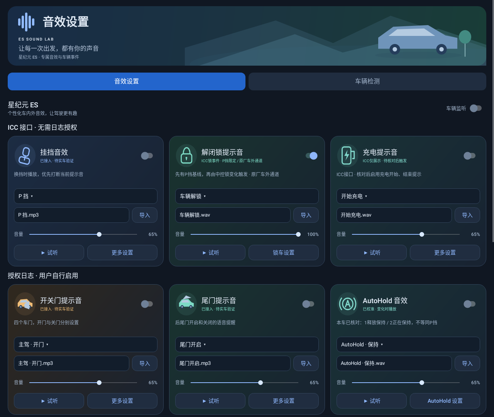

# ES 音效实验室

面向星纪元 ES 的独立 Android 音效测试 App，参考原 APK 的“星途 ES”事件接入路径重新实现。包名 `cn.es.soundlab`，与原 App 分开安装。支持 Android 8.0 及以上。

当前版本 **0.3.35（versionCode 41）**，[可覆盖升级安装包](dist/es-sound-lab-0.3.35-debug.apk)。修复合成声浪静止无怠速：声浪已启用、新鲜ICC电源ON/START、P/N/D挡及静止回复时播放怠速；D挡行驶后随车速变化，回到静止保留怠速。新增“合成怠速 / 基础音量”（默认18%，最终乘声浪总音量），以及独立的声浪模式/焦点/播放历史。自定义循环模式仍仅D挡有效车速时播放。行驶无声尚需新记录核对焦点、路由和实际输出，不宣称已完成实车修复。详见[本次日志与修复说明](docs/engine-idle-fix-20261102.md)。

本包使用工作区父目录的原始`debug.keystore`签名，证书与0.3.34一致，v2/v3签名及zipalign核验通过；覆盖安装，不卸载。`dist/build-info.json`已更新为0.3.35，历史0.3.34安装包保留。仓库`tools/debug.keystore`是另一把密钥，不用于本次覆盖升级；后续在本工作区构建请显式执行`python3 tools/build.py --keystore ../debug.keystore`。

| 来源 | 状态 | 授权与行为 |
| --- | --- | --- |
| ICC 本地接口 | 挡位、车速(km/h)、手刹/EPB、电源、充电、默认中控锁 | 开始监听即查询，无需日志或存储权限；默认完成后等待250ms，可选500/1000ms |
| 用户授权实时日志 | 四门、尾门、AutoHold、显式选择的日志锁事件 | 默认关闭，用户手动启用、授予READ_LOGS并同意系统可能出现的确认；断开不反复自动请求 |

两类同时运行、互不覆盖，不自动补位。日志关闭/拒绝不影响接口。除本车已确认的车速省略约定外，未收到、缺失与未知不当作0或关闭；失败、过期、未知挡位不补0。首样本、重连与失效恢复不播放。中控锁默认ICC，可在解闭锁设置手动切换为授权日志；后者复用旧日志锁校准，不猜测0/1方向，也不会自动开启日志。两者都要求先建立新鲜ICC P挡及锁基线，之后锁变化才触发。充电仍需单独核对确认。

新日志`ES-检测-20261101-184922.json`中，18:48:55至18:49:03的4次ICC锁变化都已通过新鲜P挡并请求播放，但系统未授予音频焦点；同一会话此前2次自动锁声进入路由匹配/放音阶段。这些失败不是ICC未触发，切回日志也不保证解决同一播放链的焦点拒绝。0.3.30补充焦点返回值及当前失败状态，不绕过焦点、不回退车内，也不宣称车外锁声已修复。尚无法将每次调用对应到车内/车外操作，也不能证明真实扬声器声音。复测不要清空、重连或长期缓存P挡，详见[本次日志与重连说明](docs/icc-reconnect-and-lock-focus-20261101.md)。

持续重试指监听服务仍运行、系统允许调度时持续请求，不等于阻止整机休眠或强制保活。系统挂起期间不能执行网络请求，唤醒恢复调度后继续；没有新增唤醒锁、定时唤醒、root或新权限。日志授权仍独立，ICC重试不会重新发起日志授权。

首页和状态大屏按来源分组，仅保留“音效设置”和“车辆检测”两个标签。移除规则管理、旧规则执行、文件/Carota读取、Mega/标准Car/消息总线/讯飞无效读取入口，以及独立ICC探针和Hub定位入口；不再申请这些车辆权限和存储读取权限。保留音频、ES日志预设、日志校准、导出和通用ADB诊断/APK提取。历史研究源码/记录保留，但不由监听服务启动。

日志分组表示使用这条读取路线，**不是承诺已验证目标车机全部四门事件**；仍须实车对照新鲜值。ICC请求本身耗时计入周期，不能保证250ms端到端实时性。

**升级注意：0.1.0 与仓库中 0.2.x 安装包的签名不同。构建0.3.35时使用与已安装版本证书一致的原密钥；本工作区为 `../debug.keystore`，通过 `--keystore` 显式指定，不得重新生成。不要为升级直接卸载旧版，否则私有音频和设置会丢失；检测JSON不是完整应用备份。旧版APK仍保留在 `dist/`。**

0.2.2 延用本工作区 0.2.0 / 0.2.1 的签名，可覆盖升级这两个版本，保留设置与私有音频；不适用于其他密钥签名的包。


## 深色模式

界面跟随Android系统报告的日间/夜间模式，无需另开应用内开关。首页音效卡片、车辆状态大屏、日志文字、音源下拉列表、设置/校准弹窗、ADB诊断/APK提取页及顶部原生绘图均使用对应配色；状态栏与导航栏同步切换。有效状态、未知状态和过期状态保留各自颜色及文字说明，不只依赖颜色辨识。

系统切换主题时重建界面，保留当前页面、音源选择、音量和已有授权设置；不改变ICC与日志分工、P挡锁声限制或播放通道。首次启动窗口也提供夜间主题，减少打开时白底闪烁。车机系统未报告夜间模式时仍显示浅色；本版不猜测车灯信号或时间来切换主题。



## 安装和首次使用

1. 将 APK 传到车机安装，打开“ES 音效实验室”。
2. 打开应用即自动启动ICC六项车况监听；本次手动停止后，再打开应用会重新启动。在“来源设置 → ICC接口：查询间隔”调整250/500/1000ms等待。接口失败后清除实时状态，并按1/2/4/8/10秒退避持续自动重试，不更换读取来源；恢复首样本不播。手动停止取消重试。
3. 需要车门、尾门和AutoHold时，进入“来源设置 → 授权日志：未启用”，阅读说明并确认。自行在系统应用信息中授予日志权限、同意可能出现的系统日志确认；没有授权也可以只使用ICC。
4. 安全驻车对照原始值，使用“统一校准”核对日志门状态/AutoHold；ES预设只对日志门类映射生效。接口挡位不套用日志预设，手刹不是AutoHold。首次新样本只建立静默基线。
5. 中控锁默认启用P挡车外提示，无需再次确认或手选设备；请安全驻车试听原厂通道。充电仍需先核对显示、确认触发并开启提示音。
6. 无变化、缺失或报错均可通过“导出记录”保留证据。日志断开后需主动重新连接，不自动反复弹授权；关闭日志不会断开ICC。车速拟合声浪默认关闭，需在声浪详情单独启用；倒车和行人循环不自动启用。

## App 内 ADB 诊断与 APK 提取（0.3.7）

在“车辆检测 → 更多 → ADB 诊断 / APK 提取”填写车机已开启的传统TCP ADB地址和实际端口，点击“连接并采集诊断”，在系统弹窗允许此次ADB连接。连接本机先用127.0.0.1，端口不能留空或猜测。配对码/TLS无线调试端口暂不支持。

自动收集车辆权限定义、本App/智行生活/ADB shell的实际授权、服务/共享库/真实包路径、所选目标的包元数据及近期相关日志。shell只读探针默认关闭，避免重复运行已知权限拒绝的方案；手动勾选后，在原shell身份下通过SDK两参数入口查询已运行服务，最多11秒，入口缺失、无服务或访问拒绝即提前结束，不绑定/启动服务、不改调用身份或权限。只在停车P挡时操作，不要求为验证切挡。

默认不选择提取包；可手填实际包名（换行/逗号分隔），也可“扫描已安装包”后按包名搜索多选。包括系统包和普通应用，但只能尝试shell有权读取的安装APK，不导出私有应用数据。手填、多选、四包/旧两包预设合并去重，每批最多64包。扫描只确认安装路径，读取可能失败；不选择任何包则仅采集诊断。用`pm path`定位基础APK和分包，ADB sync传输ZIP，记录逐文件大小/SHA-256。单文件2GiB、合计4GiB上限，每文件最长30分钟，至少保留64MiB空闲；取消或任一包失败删除本批不完整ZIP，建议分批提取。

定点诊断读取`persist.mega.car.userdebug`并区分true/false/空值/无法识别/传输错误，不把空值当关闭，也不修改它；采集ADB端口属性、网络地址/路由/TCP监听、构建指纹与安全补丁字段。车辆服务和两个已知工程包按实际`pm path`读取SHA-256输出，方便对照安装版本。命令缺失或拒绝保留原始输出；监听端口不等于局域网连接已验证，网络原始输出可能包含IP/MAC等信息。

采集后分别点击“导出 ADB 诊断”和“导出系统 APK（ZIP）”，将JSON和ZIP一起提供分析。已有本次完整APK的后续探针复测可取消勾选APK提取，只发新JSON。车辆检测“导出记录”也会附`adbDiagnostics`，但不会把APK二进制塞进JSON。失败时也能导出已有诊断；重新采集会替换最近报告，ZIP只允许导出对应本次成功提取的版本。

10月30日22:58两个APK已完整提取；23:33新版51条命令传输完成，SDK、服务及管理器均成功取得，但shell四类实际读取全部抛出对应权限SecurityException。本App和shell四项Mega授权元数据均为false，保护级别为signature|privileged；READ_LOGS不替代车辆权限，不再把同权限ADB持续桥作为已可行事件来源。新SystemUI默认分屏列表不含本App，不能将调用方extra当成任意第三方接入保证。此轮不实现持续ADB车辆桥、授权修改或车辆写入。[系统APK与新诊断结论](docs/system-apks-analysis-20261030.md)；[连接方式、采集内容和限制](docs/adb-diagnostics.md)。

## 历史：原生事件方案（0.3.0，当前已停用）

以下为旧版接入说明，当前版本不再启动此路线或显示其检测面板。当前行为以本文开头的“ICC接口 + 用户授权日志”分工为准，文件日志路线仅作历史研究保留。

通过 `MegaCar → hardware.property.CarPropertyManager` 逐项注册变化回调，覆盖四门、尾门、挡位、中控锁和AutoHold；首样本、无效恢复、重连仍只建基线。已确认缺少签名/特权权限的属性跳过直接访问；其他订阅失败项每3秒只读轮询，不阻塞其他权限域。轮询可能遗漏快速变化，不能当作实时订阅。没有自动回退日志。

检测页显示SDK来源、实际管理器、注册结果、回调/读取次数、原始值和错误；导出包含 `eventBackend`、`nativeSubscriptions`、原始时间戳及对照时钟。**注册成功不代表已经收到有效数据。** 已声明ENTRY_LOCK、CAR_DRIVING、VEHICLE_CONTROL和SEQUOIA；平台是否授权以实际返回为准，READ_LOGS不能替代。

日志辅助采集默认关闭，仅手动开启后可能请求系统日志确认。日志中的全部样本只作诊断，不触发音效或通用规则；旧日志/Android/Desay规则保留设置但暂停执行，需要从Mega原生候选重新绑定。切换扩展检测或修改规则不重建已有原生订阅及其基线。

完整接入、升级和实车验收见[原生车辆事件方案](docs/native-vehicle-events.md)。本地通过145项核心检查、70项Android/Robolectric测试和资源/Java/DEX编译；未签名打包，仍需实车确认权限、枚举及音频输出。

## 历史：分屏探测（0.3.25已移除入口和Activity注册）

以下为旧版研究记录，不是当前可用操作；全屏显示入口也已移除。

首页“分屏探测”保留早期手动请求与地图并排的四种组合，畅听按钮仅作对照。本批SystemUI默认列表不含本应用，且有导航状态条件；不要重复已失败组合。状态区可观察配对原文、当前窗口像素/dp宽度、两套宽度档位、multi-window状态和最近操作异常，不需要开启车辆监听。

调用成功不等于分屏成功。只有 `system_split_pkg` 精确包含本包与所选对手两个包名，且探测页实际窗口宽度接近870或1682px，才显示配对与宽度匹配。进入请求不使用标准Android分屏参数，不会写系统配对设置，也不会从开机或车辆事件自动进入。

退出可分别试 Provider 的“退出自己 / 退出地图 / 退出当前配对另一侧”，或 Intent 的“启动地图退出 / 启动自己退出”。Provider权限被系统拒绝时会显示完整异常，可以继续点Intent退出；额外的invalid category按钮只用于退出对照，不加入进入请求。

操作、异常和状态同时写入 `SplitProbe` 系统日志和现有 `SessionJournal`，可在车辆检测页导出的 `sessionHistory` 查看。新增 `sessionOwner` 区分探测页和监听服务，探测页创建不记作“监听服务创建”。现有关键诊断最多保留160条，长异常分段写入会占用多条；不要把历史被淘汰理解为操作没发生。

本地只验证调用构造、错误显示、窄栏界面及配置变化，不代表Mega SystemUI已经接受侧载包。已完成本批服务端静态分析，默认列表、导航条件和Provider签名权限见[系统APK结论](docs/system-apks-analysis-20261030.md)。原调用方参数及历史探测流程见[分屏协议](docs/split-screen-protocol.md)。该探测页自0.2.3加入，当前包含在0.3.5中；没有修改系统列表或签名。

`system_split_pkg` 是系统保存配对状态的设置项，并非 APK。名称含义、Mega SystemUI 的职责、权限边界与失败结果解释见[Mega SystemUI 与分屏知识笔记](docs/mega-systemui-split-notes.md)。

## 已实现的内容

| 功能 | 当前实现 |
| --- | --- |
| 挡位音效 | P / R / N / D / M 独立音频；新的可播放挡位提示抢占旧短音；退出 R 或挡位不可用始终停止倒车循环 |
| 四门提示 | 主驾、副驾、左后、右后，开门/关门分别设置 |
| 尾门提示 | 开启、关闭分别设置 |
| AutoHold 音效 | 保持/释放独立音源、音量与语速；校准实车1/2枚举后按变化播放 |
| 倒车提醒 | 音源与试听保留；日志路线暂不自动启动循环 |
| 低速行人提醒 | 设置与音源保留；日志路线暂不自动启动循环 |
| 模拟声浪 | 正式功能、默认关闭；车速/加速度拟合、三套响应曲线、可替换音源及平滑；新增可自定义马力/零百的虚拟油门动态视听，不伪造实车数据 |
| 解锁/闭锁 | ICC固定协议默认启用；先有新鲜P挡与锁基线，后续锁变化触发；自动匹配原厂车外通道 |
| 开始/结束充电 | ICC慢充/快充与未充电/待机之间变化可触发；默认只展示，需单独核对ICC充电状态并开启音效组，不等同插拔枪检测 |
| 车外语音 | 手动播放、按住说话，可选择系统枚举出的音频输出设备 |
| 自定义事件 | 旧音源及规则保留；日志模式暂不执行未知/自定义规则 |

车外扬声器是否能通过系统音频设备路由使用，需要在车上确认；普通媒体扬声器播放成功不能说明车外输出已经接通。普通音效与喊话输出设置不影响解闭锁通道。

## 中控锁与独立车外输出

当前使用ICC锁协议 `1=解锁、2=闭锁`，不再使用旧日志 `VehicleDoor/CentralLock` 的0/1校准。无需二次确认；首次升级本版将解闭锁开关设为开启、播放器增益设为100%，之后保留用户手动调整的开关及音量。既有自选音源不改动。

自动触发顺序：先收到ICC新鲜P挡，建立锁状态基线，再收到后续锁变化才播音。P挡和锁变化在首次进入P挡的同一查询中到达仍保持静默。D/R/N、未知挡位、P挡超过5秒未刷新、来源断开均不触发；离开P挡取消待播和正在播放的自动锁声，回到P挡不补播行车期间锁变化。准备完成、路由检查和最终放音前再次验证P挡。明确点击“试听”不受P挡限制。

按已分析的原厂 `com.chery.auto.carsound` 通道设置：播放器及焦点使用 `usage=2007`、内容类型MUSIC，自动精确匹配输出总线 `BUS2007_VENDOR_CONTEXT2`，设备ID变化后自动重新寻找。历史手选设备与人工确认不再参与选路；普通音效、喊话的输出设置不影响解闭锁通道。实现仍使用MediaPlayer，而非复制原厂AudioTrack播放器。

锁音播放器默认100%增益，沿用原厂usage2007音量组的当前系统音量，不强制修改全局音量或 `outside_mode`。没有可靠证据证明原厂固定数值，所以这不等于复制某个原厂音量值，也不保证物理扬声器一定更响。可以在本应用继续调低播放器音量；若系统组音量很低，需在车上核对原厂车外声音设置。

解闭锁播放器先以零音量循环等待路由，待系统报告匹配目标车外总线后，回到音频开头再放音。目标不可用、usage被系统转换/拒绝、焦点未获准、路由被拒绝、设备消失或地址不匹配时中止，不回退车内；等待最多1.5秒，放音期间通过回调和100ms复查监测。

系统API路由检查不能证明物理扬声器、功放唤醒或厂商切换瞬间绝无泄漏；普通App能否使用厂商usage也需实车验证。本地测试模拟厂商音频支持，不代表实车已验证声音大小或锁车休眠播放。

## 原 App 的音效已经内置

共 **33 个音频资源**，无需联网下载：

- 原包四门开关提示 8 个，挡位 P / R / N / D / M / S 语音。
- “公主请上车”“少爷请上车”“P 档一按好运不断”“D 档一响黄金万两”及左右后门安全带提醒。
- 原包倒车、尾门、低速行人提示音。
- “车外语音”默认使用原包“少爷请上车”的副本。
- 新增解锁、闭锁、充电开始、充电结束、自定义事件示例提示音及合成声浪。
- AutoHold 保持、释放各一个短提示音，支持替换内置音频或导入自选文件。

S 挡音频可以选用，当前没有预设独立的 S 挡自动事件。新增锁车、充电提示音属于合成示例，不能据此判断车型已支持相应事件。

点击卡片中的音频名称可选择内置音频；“导入”支持文件/U 盘。导入的音频复制到 App 私有目录，移除 U 盘后仍可使用。“更多设置”可调整单个事件语速、恢复默认音频。音量按音效组设置。

原音频出处及校验值见 [audio-provenance.json](app/src/main/assets/audio-provenance.json)。

## 声音打断规则

AutoHold 新状态会取消其旧的在播/待播提示，避免释放后还播保持；不会打断正在播放的门或挡位语音。新的可播放挡位提示仍优先抢占并清除旧的待播提示。

- **R → D：收到有效的 D 挡变化后，立即释放 R 语音和倒车循环播放器，再准备 D 语音。**
- R 音频尚未加载完成时切 D，也会取消 R；即使旧的准备/结束回调晚到，也不能重新播放 R。
- 快速 R → D → P，只保留最新 P 挡请求。没有等待旧挡位播完的队列。
- 关闭挡位语音后，退出 R 仍然停止倒车循环。D 音频文件丢失也不会导致旧 R 声音恢复。
- 挡位无效、来源重建、停止监听和“停止播放”会取消相关播放。恢复后的短播报重新建立基线。
- 普通门事件顺序排队，超过 8 秒的待播事件丢弃；语音播放期间循环音暂停。
- 保留原接入的旧版 Mega 门状态保护：80 毫秒内至少三个车门收到同值聚合广播时，只更新状态，不同时播报多门事件。独立车门状态变化仍可播报。

“立即”指 App 收到并处理最新事件时取消旧播放器；车辆属性上报、回调调度和音频设备本身的延迟需要实车测量。

## AutoHold 音效（0.2.3）

1. 找到首页“AutoHold 音效”卡片。可分别选择“保持”和“释放”，试听或更换音源；默认开关关闭。
2. 信号为 `T1CF1/AutoHold` / `0x50000022` / 区域0。0.3.29依据本车用户实测，默认1=释放保持、2=正在保持；不覆盖以前手动保存的校准。可在“AutoHold 设置 → 校准保持 / 释放状态”修改或清除。不要把功能开关、待命状态和正在保持混为一谈。
3. 开启音效组，首个有效状态只建立基线，之后保持/释放变化才播音。重复样本不重复播放；未知状态、无效状态、重新校准和日志断线都会取消旧 AutoHold 请求，恢复后重新建立基线。切换来源或重新连接也重建基线。
4. AutoHold 使用“普通音效与喊话输出”，不使用解闭锁专用车外通道。支持独立音源与语速、组音量设置；快速保持→释放取消旧 AutoHold 音效，挡位提示仍保持高优先级。
5. 检测页显示 AutoHold 状态；校准从首页“AutoHold 设置”进入，未触发原因随导出保存。导出增加 `autoHoldConfiguration`、`autoHoldTriggerStatus`，变化纳入独立 `eventHistory`，不会被方向盘连续量挤出。

只识别日志中的1/2枚举，不调用车辆控制接口，不从刹车或挡位猜测AutoHold。不把1理解成车辆必然移动，也不把2理解成P挡。

## 用检测页验证日志

1. 点击“开始监听”，核对来源；完整文件证据在“更多 → 读取详情”，确认有新增字节及有效样本。
2. “更多 → 标记当前操作”可辅助对照；一次观察一项，安全驻车，无需行驶。
3. 对照车辆状态、收到时间及导出里的候选主题、属性ID、区域和原始值。相关日志不等于已知事件，固定P或旧时间不算实时成功。
4. 已知门、尾门及挡位变化自动映射首页音效；锁和AutoHold须单独校准。未知事件只观察，不直接绑定，旧自定义规则不复活。
5. 点击“导出记录”保存JSON，包括实际打开错误、文件metadata和增量计数。0次/失败也导出，避免漏掉权限证据。

详见[文件日志路线](docs/file-log-route.md)。下面的历史目录/属性信息仍可从旧记录回看，但当前不会为收集这些字段连接已失败的车辆接口。

### 日志过滤和变化历史

默认精确过滤以下已知噪声主题：`BodyInfo/VerticalAcceleration`、`EcologyMedia/LRC`、`AVM/NtfMRAInfo`，以及已确认高频重复的 `DMS/MatchFaceid`、`DMS/CancelMatchFaceid` 及其 `/Set`、`DMS/AutoRecognition/Set`、`DMS/SyncState/Set`。不按 Lock、BodyInfo、DMS 等宽泛关键词整类屏蔽；未知主题、车门、锁状态、挡位、车速和踏板等继续保留。若某个被过滤信号已有精确绑定规则，则保留该信号，避免破坏已有自定义事件。

属性枚举不再逐条写入实时日志，而是去重保存在独立的 `propertyCatalog`。JSON 对象和数组原始值完整解析，不再在首个逗号处截断。Mega 状态区分已注册数量、实际回调、有效值和读取失败；声明 `CAR_DRIVING` 不代表车机已授权，仍以实际读取结果为准。

导出格式升级为 `schemaVersion: 2`，保留原字段并增加：

- `signalHistory`：首样本及原始值/有效状态变化的时间序列，含前值、状态、来源、属性和区域，最多 1200 条；重复值不占用历史。
- `eventHistory`：挡位、车门、尾门、中控锁等已知离散信号的独立历史，最多 400 条，不受高频车速或未知信号挤出。这是观测记录，不表示每条都实际播放了声音。
- `filteredLogs`、`historyDropped`、`eventHistoryDropped`：过滤和历史淘汰数量；`propertyCatalogDropped` 表示属性目录淘汰数。
- `lockConfiguration`、`lockOutputStatus`：当前原厂通道策略、目标usage/地址、P挡条件和路由检测结果；旧设备字段仅作历史兼容，`legacyOutputSettingsIgnored=true`。
- `audioOutputs`：系统枚举的输出设备 ID、类型、名称和地址，便于继续定位车外通道；列表本身不标识设备是否真的位于车外。

其他内存上限为最近 600 条实时日志、180 个候选、每信号 12 个不同值、60 个操作标记、2048 个属性目录条目；页面仅显示最近12行日志，候选随导出保存。“更多 → 清空记录”需确认，会清除日志、候选、变化历史和操作标记，但保留当前连接的属性目录。长时间检测请分段导出，完整信号历史不跨进程持久化，已淘汰的历史无法恢复。

### 休眠与锁车诊断（0.2.1）

- 检测页及导出增加 `lockReadiness`、`lockTriggerStatus`，区分未校准、无效值、基线、重复值、开关关闭、车外设备未确认或不可用。开启未校准的解闭锁音效时直接引导校准；校准对话框显示本会话最近观测值供对照，不自动推断枚举。
- `lockConfiguration` 增加开关、音量与两种音源；`sessionHistory` 区分手动试听、自动播放请求、路由核验后放音和失败。路由匹配不代表实际车外功放已发声。
- `runtime` / `sessionHistory` 记录进程随机标识、PID、服务会话标识、系统启动计数、含/不含系统挂起的单调时钟、屏幕交互状态与日志权限快照。记录服务创建/销毁、数据源重建、屏幕开关、用户进入、日志请求启动/结束和首条数据。看门狗发现明显的挂起时钟差会记录间隔，不把它当成整机重启。
- 最近 160 条关键诊断使用独立 SharedPreferences 异步落盘，重建服务或重启进程后继续导出，原始车辆日志不写入这个持久记录。突然断电或进程被杀可能丢失尚未落盘的末尾；缺少“服务销毁”也不能证明异常。用户清空记录会同步清空该诊断历史，并留下本次清空标记。
- 日志权限标记、系统读取批准、车辆日志实际到达是不同阶段，新版等待数据时不再直接显示“监听中”。再次看到授权窗口本身不足以判断整机重启；先核对启动计数、进程/服务标识以及日志通道重建时序。
- 不添加长期唤醒锁，不承诺普通应用能在车机深度休眠或车外功放断电时播放。先完成校准并确认事件确实到达，再依据新诊断判断是否需要厂商常电服务或车外提示音接口。

本次日志的具体时序和下一轮实车步骤见 [日志分析](docs/log-analysis-20261029-220228.md)。

### 授权请求与非音效中断修复（0.2.2）

- logcat 的 stdout 只作为日志数据，stderr 单独记录；其他应用日志正文中的 `Permission denied` / `not permitted` 不再导致主动断流。真正输出结束/启动异常记录退出码或异常，最多保留本次前 16 条 stderr。
- 0.2.2旧方案中，标准/扩展模式共用一个日志进程，标准模式在读取线程按原标签过滤；规则改变只重建车辆接口。0.3.0默认不开启日志，规则改变也不再重建已有原生订阅。车辆和日志使用不同 generation，防止车辆重连使日志回调失效，也不再清空其他来源的锁/门基线。
- 真正断流后暂停自动重试，显示“回到前台点击重新连接”，避免每 5 秒重复启动授权请求。0.2.x旧方案在断流期间无法恢复日志锁事件；0.3.0的Mega原生锁订阅不受辅助日志断流影响。这不是系统永久日志授权方案。无日志权限时仍可每 5 秒检查权限标记，不会启动 logcat 或弹读取窗口。
- 读取宽范围 logcat 仍有 CPU/IO 成本；无关行在读取线程丢弃、已知噪声在进入主线程队列前过滤，不持久保留全部日志。队列仍上限 128，新增 `logQueueDropped` 显示拥塞丢弃，防止无声丢样。
- 无效/恢复基线、来源重置、普通设置变化不再全局停止短音效。关闭/静音/缺失音源等没有可播放提示的挡位事件不抢占正在播放的门/挡位短音；离开 R 或挡位失效仍停止倒车循环和清理过期挡位队列。新可播放的高优先级事件、显式试听、手动停止和真实音频焦点丢失仍按策略打断；文件预检不保证随后解码、焦点和路由一定成功。
- 关闭某个正在播放的音效组、改变其输出、改变锁设备/校准仍可有针对性地取消对应播放，不影响无关音效；音源设置仅影响后续请求，音量/语速尽量原位更新。

完整证据和验证步骤见 [22:42 日志分析](docs/log-analysis-20261029-224225.md)。

## 构建和验证

macOS 下安装 JDK 17+、Python 3.9+ 后：

```sh
python3 tools/build.py --keystore ../debug.keystore
```

首次自动下载并校验固定版本 Android SDK 工具，输出 APK 到 `dist/`，校验包对齐和签名。`dist/build-info.json` 包含 SHA-256。覆盖升级须用 `--keystore` 指定与已安装版本证书一致的原密钥；明确指定的路径不存在时直接报错，不会新建或替换密钥。未指定路径的旧调试流程仍使用 `tools/debug.keystore`，不能据此保证与发布包兼容。

纯 Java 协议和状态转换检查：

```sh
python3 tools/build.py --test-only
```

只检查资源、Java 和 DEX 编译，不签名、不改动历史 APK：

```sh
python3 tools/build.py --compile-only
```

Android 原生界面及播放生命周期回归检查（先构建；依赖 Maven 和 JDK 21）：

```sh
python3 tools/ui_check.py
```

可用 `ES_SOUNDLAB_JAVA_HOME` 指定 JDK 21 目录。检查使用 Robolectric，截图输出到 `dist/screenshots/`。播放器生命周期测试替代真实音频解码，不能代替车机上的声音和路由测试。

也可将此目录作为 Gradle 项目导入 Android Studio（AGP 8.7.3 / compileSdk 35）。没有附带 Gradle wrapper，可由 IDE 使用相应 Gradle 版本。

当前源码通过协议/状态检查和 Android 界面、读取与播放生命周期回归，新增 AutoHold 校准、首样本、重复/无效状态、快速切换、过期回调、来源恢复、排队与挡位抢占覆盖；具体结果见项目交接说明。`--compile-only` 已验证资源、Java 和 DEX。当前包含33个音频资源，正式签名安装包由原构建环境生成。实车事件、后台存活和扬声器路由仍需上车验证。

原 APK 解包分析见 [原 APK 音效与车辆事件分析](docs/original-apk-analysis.md)。

## 项目知识与交接

- [App内ADB只读诊断](docs/adb-diagnostics.md)：连接实际端口、标准授权、采集权限/服务/近期日志和合并导出。

- [原生车辆事件方案](docs/native-vehicle-events.md)：0.3.0接入、枚举配置、权限与失败诊断、升级及实车验收。

- [新提取车机 APK 接口分析](docs/vehicle-apk-research-20261030.md)：11个样本的签名与权限、Mega直接车辆订阅、车外音频2007/outside_mode、空调接入候选和现有适配缺口；附属性目录与只读ADB采集脚本。
- [项目交接与已知结论](docs/project-notes.md)：代码导航、四份实车日志结论、车外通道约束、已实现与待验证功能、签名和构建注意事项。
- [Android 13 日志授权与替代方案](docs/log-access-android13.md)：权限与“允许一次”的区别、重复请求原因、已实现连接复用及 Shizuku / ADB / 厂商接口方案、一手参考。**特权免弹窗后端尚未实现，真正断流需手动恢复。**
- [2026-10-29 22:02 日志分析](docs/log-analysis-20261029-220228.md)：锁状态未校准的确定阻断条件、行驶/电源时序及下一轮实车步骤。
