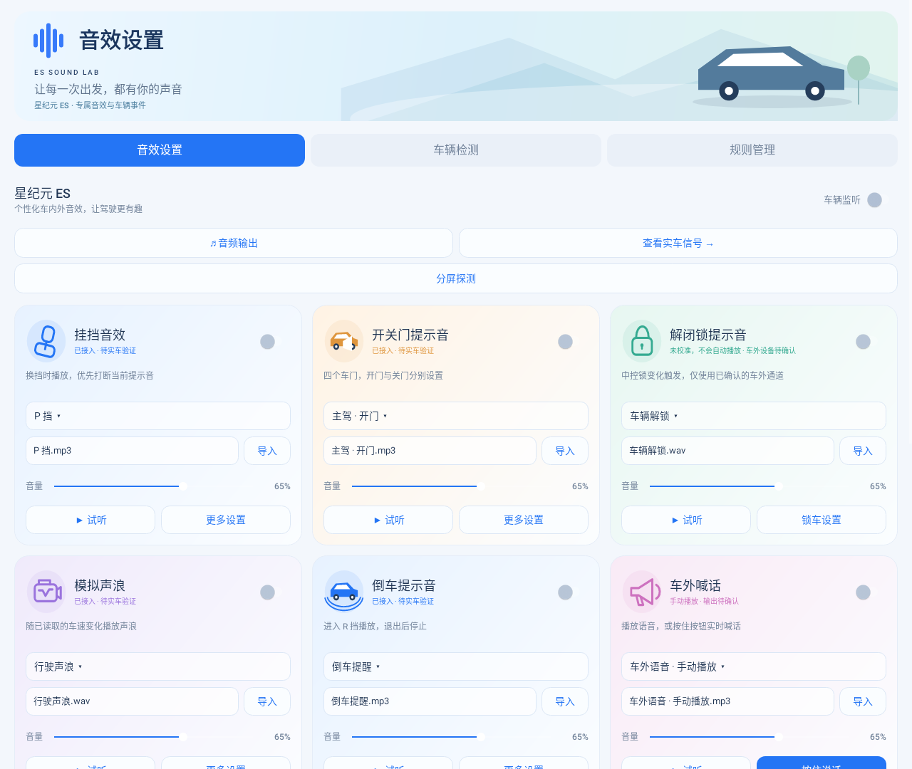

# ES 音效实验室

面向星纪元 ES 的独立 Android 音效测试 App，参考原 APK 的“星途 ES”事件接入路径重新实现。包名 `cn.es.soundlab`，与原 App 分开安装。支持 Android 8.0 及以上。

当前源码版本 **0.2.3（versionCode 5）**，新增 AutoHold 音效和分屏探测页。本次仅更新源码并验证，正式包由用户在保留 0.2.x 原签名密钥的环境构建；仓库中的[最近安装包仍为 0.2.2](dist/es-sound-lab-0.2.2-debug.apk)，尚不包含 AutoHold 和分屏探测功能，`dist/build-info.json` 也仍描述该历史安装包。

**升级注意：0.1.0 与仓库中 0.2.x 安装包的签名不同。构建 0.2.3 时请在原 0.2.x 构建环境保留并使用 `tools/debug.keystore`，不要新建或替换为 0.1.0 的密钥。不要为升级直接卸载旧版，否则私有音频和设置会丢失；检测 JSON 不是完整应用备份。旧版 APK 仍保留在 `dist/`。**

0.2.2 延用本工作区 0.2.0 / 0.2.1 的签名，可覆盖升级这两个版本，保留设置与私有音频；不适用于其他密钥签名的包。



## 安装和首次使用

1. 将 APK 传到车机安装，打开“ES 音效实验室”。
2. 在应用管家中，为 **ES 音效实验室 / cn.es.soundlab** 授予“读取系统日志”权限。原 App 已有的授权不会转移到新 App。
3. 进入“车辆检测”，点击“重新连接”，查看日志权限和车辆接口的实际状态。
4. 在“音效设置”启用需要的音效组。初始开关全部关闭，可先用“试听”检查音频输出、音量。
5. 返回检测页操作车辆，确认车门、挡位等状态变化。刚连接、切换来源或无效数据恢复后的首个状态仅建立基线，不播报短提示音；之后的真实变化才触发。倒车等循环音按照当前有效状态运行。

可在应用管家允许后台运行和开机启动。App 使用前台服务保持监听，并在已开启监听的情况下尝试开机恢复；车机系统仍可能限制后台进程。

## 分屏探测（源码功能，待实车验证）

首页“分屏探测”打开独立探测页，手动请求与地图并排。分别测试“启动地图 / 启动自己”及把手左 / 右四种组合；畅听按钮仅作对照。状态区保留配对原文、当前窗口像素/dp宽度、两套宽度档位、multi-window状态和最近操作异常，不需要开启车辆监听。

调用成功不等于分屏成功。只有 `system_split_pkg` 精确包含本包与所选对手两个包名，且探测页实际窗口宽度接近870或1682px，才显示配对与宽度匹配。进入请求不使用标准Android分屏参数，不会写系统配对设置，也不会从开机或车辆事件自动进入。

退出可分别试 Provider 的“退出自己 / 退出地图 / 退出当前配对另一侧”，或 Intent 的“启动地图退出 / 启动自己退出”。Provider权限被系统拒绝时会显示完整异常，可以继续点Intent退出；额外的invalid category按钮只用于退出对照，不加入进入请求。

操作、异常和状态同时写入 `SplitProbe` 系统日志和现有 `SessionJournal`，可在车辆检测页导出的 `sessionHistory` 查看。新增 `sessionOwner` 区分探测页和监听服务，探测页创建不记作“监听服务创建”。现有关键诊断最多保留160条，长异常分段写入会占用多条；不要把历史被淘汰理解为操作没发生。

本地只验证调用构造、错误显示、窄栏界面及配置变化，不代表Mega SystemUI已经接受侧载包。四种地图请求都无法改变配对和宽度时，按协议停止尝试，不猜新接口。接口依据与实车步骤见[分屏协议](docs/split-screen-protocol.md)。本次沿用0.2.3源码版本，不另生成签名安装包。

`system_split_pkg` 是系统保存配对状态的设置项，并非 APK。名称含义、Mega SystemUI 的职责、权限边界与失败结果解释见[Mega SystemUI 与分屏知识笔记](docs/mega-systemui-split-notes.md)。

## 已实现的内容

| 功能 | 当前实现 |
| --- | --- |
| 挡位音效 | P / R / N / D / M 独立音频；新的可播放挡位提示抢占旧短音；退出 R 或挡位不可用始终停止倒车循环 |
| 四门提示 | 主驾、副驾、左后、右后，开门/关门分别设置 |
| 尾门提示 | 开启、关闭分别设置 |
| AutoHold 音效 | 保持/释放独立音源、音量与语速；校准实车1/2枚举后按变化播放 |
| 倒车提醒 | R 挡循环，退出 R 立即停止；让位于短语音 |
| 低速行人提醒 | 依据有效挡位和最近 5 秒内的车速；可设置速度上限 |
| 模拟声浪 | 随读取到的车速调节合成循环声，未使用未经确认的电机转速 |
| 解锁/闭锁 | 已识别实车中控锁信号，校准枚举后触发；必须单独选择并确认车外输出 |
| 开始/结束充电 | 自带示例提示音，需检测并绑定实车信号 |
| 车外语音 | 手动播放、按住说话，可选择系统枚举出的音频输出设备 |
| 自定义事件 | 从检测候选信号创建独立事件，并导入自己的声音 |

车外扬声器是否能通过系统音频设备路由使用，需要在车上确认；普通媒体扬声器播放成功不能说明车外输出已经接通。普通音效与喊话输出设置不影响解闭锁通道。

## 中控锁与独立车外输出

实车日志已出现 `VehicleDoor/CentralLock`，属性 `0x67000096`（1728053398），区域 `0x0`。2026-10-29 22:02 导出的新日志已记录 `0/1` 多次变化，但两个校准值仍为空，这是自动播放的确定阻断条件。App 不预设 `0/1` 的含义，必须按实际操作时刻确认，不能用选择音源或试听代替状态校准。

22:42 的后续日志已完成配置，但只保留一个锁原始值 `0`（作为首样本），紧接着日志读取异常并重连，没有后续锁变化和自动播放请求。这次不能再归因“未校准”。0.2.2 修复日志正文的权限拒绝文字被当成读取失败、模式切换重建日志连接，以及其他来源重连清空锁基线的问题；仍不把首样本当自动播放事件。

1. 在检测页开始扩展检测，分别标记并执行锁车、解锁，重复数次后导出记录。对照 `eventHistory` / `signalHistory` 的时间和原始值确认含义。
2. 在“解闭锁提示音 → 锁车设置 → 校准中控锁状态”填写两个不同的实际整数值。也可以点击中控锁候选条目的“绑定音效”进入校准。此信号使用专用接入，不再执行通用规则，避免重复播放或绕过车外输出约束。
3. 在“选择车外输出设备”中选择系统枚举的目标设备，没有系统默认输出选项。通过“测试所选车外设备”或卡片“试听”手动测试，并亲自在车外确认目标扬声器。确认后再点击“确认该设备为车外扬声器”，授权自动播放。
4. 开启解闭锁音效组，再次锁车/解锁验证。首样本、重复值、来源恢复和重新校准后的首样本不播报；未知值或无效状态取消正在播放的解闭锁音效并重建基线。

解闭锁播放器先以零音量循环等待路由，待系统报告实际路由匹配所选设备后，关闭循环、回到音频开头再放音，避免短提示音在核验期间耗尽。未配置、自动播放未获人工确认、路由被拒绝、设备消失或路由不匹配时中止，不主动回退普通输出；路由建立等待最多 1.5 秒，播放中通过路由回调和 100 毫秒复查监测。设备 ID、类型、名称、地址必须匹配，变化后需重选并重新确认。

这些是系统 API 层面的路由检查，不代表已经确认物理车外扬声器，也不能保证厂商系统切换路由期间绝无瞬时泄漏。如果目标通道不在设备列表内，或厂商忽略/错误报告路由，需要进一步定位厂商车外音频接口；当前未猜测或调用未知厂商写入接口。车机锁车休眠后的进程、音频和功放可用性也需要实车验证。

接入包括 Desay CarInfo、Mega 车辆属性、Android CarProperty，以及 `MessageProperty` 等车辆日志。只读取数据，不调用车辆控制写入接口。接口可见性和权限以检测页结果为准。

## 原 App 的音效已经内置

共 **33 个音频资源**，无需联网下载：

- 原包四门开关提示 8 个，挡位 P / R / N / D / M / S 语音。
- “公主请上车”“少爷请上车”“P 档一按好运不断”“D 档一响黄金万两”及左右后门安全带提醒。
- 原包倒车、尾门、低速行人提示音。
- “车外语音”默认使用原包“少爷请上车”的副本。
- 新增解锁、闭锁、充电开始、充电结束、自定义事件示例提示音及合成声浪。
- AutoHold 保持、释放各一个短提示音，支持替换内置音频或导入自选文件。

S 挡音频可以选用，当前没有预设独立的 S 挡自动事件。新增锁车、充电提示音属于合成示例，不能据此判断车型已支持相应事件。

点击卡片中的音频名称可选择内置音频；“导入”支持文件/U 盘。导入的音频复制到 App 私有目录，移除 U 盘后仍可使用。“更多设置”可调整单个事件语速、恢复默认音频。音量按音效组设置。

原音频出处及校验值见 [audio-provenance.json](app/src/main/assets/audio-provenance.json)。

## 声音打断规则

AutoHold 新状态会取消其旧的在播/待播提示，避免释放后还播保持；不会打断正在播放的门或挡位语音。新的可播放挡位提示仍优先抢占并清除旧的待播提示。

- **R → D：收到有效的 D 挡变化后，立即释放 R 语音和倒车循环播放器，再准备 D 语音。**
- R 音频尚未加载完成时切 D，也会取消 R；即使旧的准备/结束回调晚到，也不能重新播放 R。
- 快速 R → D → P，只保留最新 P 挡请求。没有等待旧挡位播完的队列。
- 关闭挡位语音后，退出 R 仍然停止倒车循环。D 音频文件丢失也不会导致旧 R 声音恢复。
- 挡位无效、来源重建、停止监听和“停止播放”会取消相关播放。恢复后的短播报重新建立基线。
- 普通门事件顺序排队，超过 8 秒的待播事件丢弃；语音播放期间循环音暂停。
- 保留原接入的旧版 Mega 门状态保护：80 毫秒内至少三个车门收到同值聚合广播时，只更新状态，不同时播报多门事件。独立车门状态变化仍可播报。

“立即”指 App 收到并处理最新事件时取消旧播放器；车辆上报、日志到达和音频设备本身的延迟需要实车测量。

## AutoHold 音效（0.2.3）

1. 找到首页“AutoHold 音效”卡片。可分别选择“保持”和“释放”，试听或更换音源；默认开关关闭。
2. 在“AutoHold 设置 → 校准保持 / 释放状态”填写实车对应的 `1`、`2`。信号为 `T1CF1/AutoHold` / `0x50000022` / 区域0；本次行程日志确认有两种值，但没有操作标记确认含义，因此不预设映射。不要把功能开关、待命状态和正在保持混为一谈。
3. 开启音效组，首个有效状态只建立基线，之后保持/释放变化才播音。重复样本不重复播放；未知状态、无效状态、重新校准和日志重连都会取消旧 AutoHold 请求，恢复后重新建立基线。无关车辆接口重连不清除日志基线。
4. AutoHold 使用“普通音效与喊话输出”，不使用解闭锁专用车外通道。支持独立音源与语速、组音量设置；快速保持→释放取消旧 AutoHold 音效，挡位提示仍保持高优先级。
5. 检测页显示 AutoHold 状态与未触发原因；候选条目的绑定入口进入专用校准，避免通用规则重复触发。导出增加 `autoHoldConfiguration`、`autoHoldTriggerStatus`，变化纳入独立 `eventHistory`，不会被方向盘连续量挤出。

本次只识别日志中已观察到的1/2枚举，不调用车辆控制接口，不从刹车或挡位猜测 AutoHold 状态。仍需上车确认枚举方向和保持/释放实际行为。

## 用检测页拓展事件

1. 点击“开始扩展检测”。这会收集车辆相关日志，并枚举当前能够读取的更多车辆属性。
2. 点击“标记当前操作”，写下准备进行的动作，例如“车辆解锁”，再执行该动作。每次只改变一项，重复数次观察。
3. 比较候选信号的主题、属性 ID、区域、当前值和变化次数。候选信号不代表已经确定其含义。
4. 点击候选条目 →“绑定音效”，填写实际触发值，选择已有事件或新建事件名称。规则精确匹配来源、主题、属性 ID、区域和原始值；首样本和重复值不会触发。
5. 保存后会启用该音效组，再次操作车辆验证。需要时可以在“规则管理”删除规则。
6. 点击“导出记录”，保存 JSON。文件包含设备/权限信息、接口状态、候选值、操作标记、最近日志和绑定规则，便于继续分析。

可重点观察锁状态、充电枪连接/充电状态、后备厢、车窗、座椅/安全带、灯光等操作是否产生可读信号。当前没有确认这些拓展信号的枚举含义，也不保证各年款都会公开。扩展检测使用车辆关键词筛选日志；能自动解析的属性结构才进入候选列表，其余相关日志保留在实时日志中供分析。

### 日志过滤和变化历史

默认精确过滤以下已知噪声主题：`BodyInfo/VerticalAcceleration`、`EcologyMedia/LRC`、`AVM/NtfMRAInfo`，以及已确认高频重复的 `DMS/MatchFaceid`、`DMS/CancelMatchFaceid` 及其 `/Set`、`DMS/AutoRecognition/Set`、`DMS/SyncState/Set`。不按 Lock、BodyInfo、DMS 等宽泛关键词整类屏蔽；未知主题、车门、锁状态、挡位、车速和踏板等继续保留。若某个被过滤信号已有精确绑定规则，则保留该信号，避免破坏已有自定义事件。

属性枚举不再逐条写入实时日志，而是去重保存在独立的 `propertyCatalog`。JSON 对象和数组原始值完整解析，不再在首个逗号处截断。Mega 状态区分连接成功和本轮属性读取成功数量；声明 `CAR_DRIVING` 不代表车机已授权，仍以实际读取结果为准。

导出格式升级为 `schemaVersion: 2`，保留原字段并增加：

- `signalHistory`：首样本及原始值/有效状态变化的时间序列，含前值、状态、来源、属性和区域，最多 1200 条；重复值不占用历史。
- `eventHistory`：挡位、车门、尾门、中控锁等已知离散信号的独立历史，最多 400 条，不受高频车速或未知信号挤出。这是观测记录，不表示每条都实际播放了声音。
- `filteredLogs`、`historyDropped`、`eventHistoryDropped`：过滤和历史淘汰数量；`propertyCatalogDropped` 表示属性目录淘汰数。
- `lockConfiguration`、`lockOutputStatus`：锁状态校准、所选输出设备、人工确认状态和路由检测结果。
- `audioOutputs`：系统枚举的输出设备 ID、类型、名称和地址，便于继续定位车外通道；列表本身不标识设备是否真的位于车外。

其他内存上限为最近 600 条实时日志、180 个候选、每信号 12 个不同值、60 个操作标记、2048 个属性目录条目；页面显示最近 40 个候选。清空记录会清除日志、候选、变化历史和操作标记，但保留当前连接的属性目录。长时间检测请分段导出，完整信号历史不跨进程持久化，已淘汰的历史无法恢复。

### 休眠与锁车诊断（0.2.1）

- 检测页及导出增加 `lockReadiness`、`lockTriggerStatus`，区分未校准、无效值、基线、重复值、开关关闭、车外设备未确认或不可用。开启未校准的解闭锁音效时直接引导校准；校准对话框显示本会话最近观测值供对照，不自动推断枚举。
- `lockConfiguration` 增加开关、音量与两种音源；`sessionHistory` 区分手动试听、自动播放请求、路由核验后放音和失败。路由匹配不代表实际车外功放已发声。
- `runtime` / `sessionHistory` 记录进程随机标识、PID、服务会话标识、系统启动计数、含/不含系统挂起的单调时钟、屏幕交互状态与日志权限快照。记录服务创建/销毁、数据源重建、屏幕开关、用户进入、日志请求启动/结束和首条数据。看门狗发现明显的挂起时钟差会记录间隔，不把它当成整机重启。
- 最近 160 条关键诊断使用独立 SharedPreferences 异步落盘，重建服务或重启进程后继续导出，原始车辆日志不写入这个持久记录。突然断电或进程被杀可能丢失尚未落盘的末尾；缺少“服务销毁”也不能证明异常。用户清空记录会同步清空该诊断历史，并留下本次清空标记。
- 日志权限标记、系统读取批准、车辆日志实际到达是不同阶段，新版等待数据时不再直接显示“监听中”。再次看到授权窗口本身不足以判断整机重启；先核对启动计数、进程/服务标识以及日志通道重建时序。
- 不添加长期唤醒锁，不承诺普通应用能在车机深度休眠或车外功放断电时播放。先完成校准并确认事件确实到达，再依据新诊断判断是否需要厂商常电服务或车外提示音接口。

本次日志的具体时序和下一轮实车步骤见 [日志分析](docs/log-analysis-20261029-220228.md)。

### 授权请求与非音效中断修复（0.2.2）

- logcat 的 stdout 只作为日志数据，stderr 单独记录；其他应用日志正文中的 `Permission denied` / `not permitted` 不再导致主动断流。真正输出结束/启动异常记录退出码或异常，最多保留本次前 16 条 stderr。
- 标准/扩展模式共用一个日志进程，标准模式在读取线程按原标签过滤；规则改变只重建车辆接口。车辆和日志使用不同 generation，防止车辆重连使日志回调失效，也不再清空其他来源的锁/门基线。
- 真正断流后暂停自动重试，显示“回到前台点击重新连接”，避免每 5 秒重复启动授权请求。代价是断流期间不能自动恢复锁事件监听；这不是系统永久授权方案。无日志权限时仍可每 5 秒检查权限标记，不会启动 logcat 或弹读取窗口。
- 读取宽范围 logcat 仍有 CPU/IO 成本；无关行在读取线程丢弃、已知噪声在进入主线程队列前过滤，不持久保留全部日志。队列仍上限 128，新增 `logQueueDropped` 显示拥塞丢弃，防止无声丢样。
- 无效/恢复基线、来源重置、普通设置变化不再全局停止短音效。关闭/静音/缺失音源等没有可播放提示的挡位事件不抢占正在播放的门/挡位短音；离开 R 或挡位失效仍停止倒车循环和清理过期挡位队列。新可播放的高优先级事件、显式试听、手动停止和真实音频焦点丢失仍按策略打断；文件预检不保证随后解码、焦点和路由一定成功。
- 关闭某个正在播放的音效组、改变其输出、改变锁设备/校准仍可有针对性地取消对应播放，不影响无关音效；音源设置仅影响后续请求，音量/语速尽量原位更新。

完整证据和验证步骤见 [22:42 日志分析](docs/log-analysis-20261029-224225.md)。

## 构建和验证

macOS 下安装 JDK 17+、Python 3.9+ 后：

```sh
python3 tools/build.py
```

首次自动下载并校验固定版本 Android SDK 工具，输出 APK 到 `dist/`，校验包对齐和签名。`dist/build-info.json` 包含 SHA-256。本地调试密钥自动生成于 `tools/debug.keystore`，后续覆盖升级需要保留同一密钥。

纯 Java 协议和状态转换检查：

```sh
python3 tools/build.py --test-only
```

只检查资源、Java 和 DEX 编译，不签名、不改动历史 APK：

```sh
python3 tools/build.py --compile-only
```

Android 原生界面及播放生命周期回归检查（先构建；依赖 Maven 和 JDK 21）：

```sh
python3 tools/ui_check.py
```

可用 `ES_SOUNDLAB_JAVA_HOME` 指定 JDK 21 目录。检查使用 Robolectric，截图输出到 `dist/screenshots/`。播放器生命周期测试替代真实音频解码，不能代替车机上的声音和路由测试。

也可将此目录作为 Gradle 项目导入 Android Studio（AGP 8.7.3 / compileSdk 35）。没有附带 Gradle wrapper，可由 IDE 使用相应 Gradle 版本。

当前源码通过协议/状态检查和 Android 界面、读取与播放生命周期回归，新增 AutoHold 校准、首样本、重复/无效状态、快速切换、过期回调、来源恢复、排队与挡位抢占覆盖；具体结果见项目交接说明。`--compile-only` 已验证资源、Java 和 DEX。当前包含33个音频资源，正式签名安装包由原构建环境生成。实车事件、后台存活和扬声器路由仍需上车验证。

原 APK 解包分析见 [原 APK 音效与车辆事件分析](docs/original-apk-analysis.md)。

## 项目知识与交接

- [新提取车机 APK 接口分析](docs/vehicle-apk-research-20261030.md)：11个样本的签名与权限、Mega直接车辆订阅、车外音频2007/outside_mode、空调接入候选和现有适配缺口；附属性目录与只读ADB采集脚本。
- [项目交接与已知结论](docs/project-notes.md)：代码导航、四份实车日志结论、车外通道约束、已实现与待验证功能、签名和构建注意事项。
- [Android 13 日志授权与替代方案](docs/log-access-android13.md)：权限与“允许一次”的区别、重复请求原因、已实现连接复用及 Shizuku / ADB / 厂商接口方案、一手参考。**特权免弹窗后端尚未实现，真正断流需手动恢复。**
- [2026-10-29 22:02 日志分析](docs/log-analysis-20261029-220228.md)：锁状态未校准的确定阻断条件、行驶/电源时序及下一轮实车步骤。
