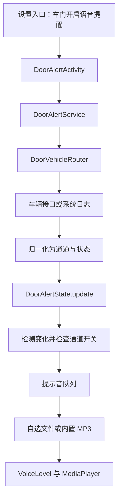

# 原 APK 音效与车辆事件分析

本报告来自本地静态分析。下文的解包、反编译、Smali 和音频清单路径指本地分析材料；仓库提供本报告，完整解包目录保留在本地。

分析对象：`yuhan-2.0.666-gear-alert-interrupt-local-test.apk`。

**结论：该 APK 有完整的四门开门、关门语音提醒实现，可以单独替换各个门、各个状态的音频。锁车部分找到了属性定义和部分车型的日志匹配配置，但在已追踪的提醒和规则代码中，未发现“真实锁车事件 → 音效播放”的完整独立实现。关门提示不能视为锁车提示。**

这是静态解包与反编译结果，尚未在车机上运行验证。

**1. 已保存的分析材料**

所有输出位于本文件所在目录，原 APK 未修改。

| 输出 | 内容 |
| --- | --- |
| `unpacked/` | APK 的 1610 个 ZIP 条目，包含原始 DEX、资源和音频 |
| `decoded-resources/resources/AndroidManifest.xml` | 解码后的清单文件 |
| `decompiled/sources/com/yuhan/music2/` | 车门、车辆接口、音频播放及独立车辆工具相关 Java 反编译结果 |
| `smali/classes50/` | 核心车门模块的 Smali，用于核对反编译结果 |
| `audio-inventory.csv`、`audio-inventory.json` | 20 个 door-alerts 音频和 2 个尾门音频的格式、时长、大小 |
| `dex-defined-classes.json` | 各 DEX 中实际定义的类，区别于仅被引用的类 |
| `dex-class-index.json` | 各 DEX 中出现的 com.yuhan 类描述符，包括引用 |
| `sound-string-hits.json`、`lock-string-hits.json` | 音效、车门和锁车相关 DEX 字符串线索 |

应用包名：`com.luna.music.car`；versionName：`2.0.666`；versionCode：`200666`；minSdk：24；targetSdk：28。

APK SHA-256：`fc1c7af58e4ae1d31aefb6e549eb72c3b54e46fcdf74b4d744c12b5e274f0a05`。

**2. 开门、关门音频在哪里**

核心资源目录是 `unpacked/assets/door-alerts/`，以下路径均相对于该目录。

| 车门 | 通道 | 开门音频 | 时长 | 关门音频 | 时长 |
| --- | --- | --- | --- | --- | --- |
| 主驾 | 0 | `door_front_left_open.mp3` | 3.288 秒 | `door_front_left_closed.mp3` | 3.480 秒 |
| 副驾 | 1 | `door_front_right_open.mp3` | 3.408 秒 | `door_front_right_closed.mp3` | 3.528 秒 |
| 左后 | 2 | `door_rear_left_open.mp3` | 3.288 秒 | `door_rear_left_closed.mp3` | 3.384 秒 |
| 右后 | 3 | `door_rear_right_open.mp3` | 3.288 秒 | `door_rear_right_closed.mp3` | 3.336 秒 |

这 8 个默认门音频均为 MP3、24 kHz、单声道。时长来自 ffprobe；本次没有逐条听写，文件名与 UI 名称不能替代对完整播报文案的试听。

`options/` 还包含：

- `少爷请上车.mp3`、`公主请上车.mp3`：四个门的开门事件均可选择，均约 1.104 秒。
- `左后门已关闭，请系好安全带.mp3`、`右后门已关闭，请系好安全带.mp3`：对应后门的关门事件可选择，约 3.264 / 3.240 秒。
- `P档一按好运不断.mp3`、`D档一响黄金万两.mp3`：挡位提示的可选音频。

另有 `gear_p/r/n/d/m/s.mp3`。当前 `DoorSounds.GEARS` 和 `DoorAlerts.sound()` 的主映射是 P/R/N/D/M；不能仅凭存在 `gear_s.mp3` 就认定页面提供独立 S 挡配置。

尾门是另一组资源：`unpacked/assets/yuhan_vehicle/tailgate_open.mp3` 和 `tailgate_close.mp3`，分别约 1.536 / 1.728 秒，由 `DoorExtra*` 模块负责。

**3. 开门、关门如何触发**

核心调用关系：



`DoorAlertState` 对四门使用 `0=关门`、`1=开门`。只有旧状态和新状态都有效、且两者不同，才生成播报事件：

- `0 → 1`：播放该门的开门音频。
- `1 → 0`：播放该门的关门音频。
- 首次读到状态：建立基线，不播报。
- 同一个状态反复上报：不重复播报。
- 无效状态：不会直接触发；恢复有效值时重新建立基线。

四门各有一个开关，默认关闭；同一个门的开关同时控制开门和关门，没有发现两个状态各自独立的启用开关。音频和语速则可以按状态分别设置。

对应代码：`DoorAlerts.java`、`DoorAlertState.java`、`DoorAlertService.java`、`DoorSounds.java`，均在 `classes50.dex`。

**4. 自定义音频与播放设置**

设置入口标题是“车门开启语音提醒”。页面提供四门、挡位，以及附加的尾门、低速行人、倒车提醒设置。

车门音频支持内置选项、系统文件选择器、车机本地 / U 盘选择。导入时复制到应用私有目录 `files/door-alerts/`，单文件上限是 20 MiB，并检查音频时长有效。用户导入的文件存放在已安装应用的数据目录，不在原 APK 内。

设置使用 SharedPreferences：`yuhan_door_alerts`。

| 键 | 含义 | 例子 |
| --- | --- | --- |
| `enabled_<channel>` | 开启该门或挡位通道，默认 false | `enabled_0`：主驾 |
| `file_<channel>_<value>` | 导入音频的私有文件绝对路径 | `file_0_1`：主驾开门 |
| `asset_<channel>_<value>` | 所选内置音频的名称 | `asset_0_1` |
| `name_<channel>_<value>` | 自选文件显示名称 | `name_0_1` |
| `volume_<channel>` | 同一通道的音量，默认 50 | `volume_0` |
| `speed_<channel>_<value>` | 按门和开/关状态保存语速 | `speed_0_1` |
| `door_vehicle_profile` | 车型读取模式，0/1/2/3 | 自动 / 风云T9 / 星途ES / 星途ET |

播放选择顺序：存在且有效的自选文件 → 所选内置音频 → 默认音频。语速范围 0.5–2.0 倍，默认 1.0 倍，音高保持 1.0。

`VoiceLevel` 会异步解码、统一响度并缓存为 WAV；缓存目录为 `voice-level-v2`，处理失败时尝试原音频。核心门播报通过 Android `MediaPlayer` 播放，AudioAttributes 为 `usage=13`、`contentType=1`。这条链路没有显式选择车外扬声器，不能据此保证会从原车锁车喇叭或车外扬声器发声。

这个版本音量滑条上限实际为 1000，UI 可显示 1000%；服务直接把保存值除以 100 传给 `MediaPlayer.setVolume()`。因此“显示 1000%”不等于已验证的十倍硬件增益，实际效果需在目标车机验证。

**5. 多个音效同时发生，以及 interrupt 的含义**

`DoorAlertService` 使用一个播放器和一个队列：

- 新门事件会移除队列中同一门尚未播放的旧事件，然后排队。
- 普通门事件不会立即打断当前正在播放的音效。
- 启用了挡位提示且挡位发生变化时，会清空等待队列、释放当前播放器，并播放新的挡位提示。
- 等待超过 8 秒的队列事件会被丢弃。
- 手动试听也会清空队列并打断当前播放。

挡位打断行为在 `DoorAlertService.java` 的状态处理方法中，已与 `classes50.dex` 的 Smali 核对。它与文件名中的 `gear-alert-interrupt` 相符，具体原始修改历史无法仅从该 APK 确定。

**6. 车辆数据从哪里读取，尤其是星途 ES**

`DoorVehicleRouter` 根据车型设置选择读取方式：

| 模式 | 读取路径 |
| --- | --- |
| 自动（0）/ 星途ES（2） | `DoorVehicleClient`；优先使用可用的德赛 CarInfo 服务，否则尝试 Mega，再否则使用 Android CarPropertyManager |
| 风云T9（1） | 日志读取，内部委托 `T9ReferenceLogClient` / `T9ReferenceLogDecoder` |
| 星途ET（3） | `T9DoorLogClient`，读取 MessageProperty 和 VCU_PRNDGearAct 日志 |

德赛路径的服务为 `com.desaysv.ivi.vds.carinfo.service.CarInfoService`；Binder 描述符为 `com.desaysv.ivi.vdb.IVDBus`，模块号 `327684`。订阅和读取命令只有 `{15,16,17,18,26}`，对应四门和挡位；另有 5 秒轮询。

Android 标准属性主要是 `DOOR_POS=373295872`、`GEAR_SELECTION=289408000`、`CURRENT_GEAR=289408001`。Mega 四门属性为 `100663340` 至 `100663343`，挡位为 `67108874`；Mega 兼容实现还包含日志和属性回退。

日志读取识别 `VehicleDoor/Door/FrontLeft`、`FrontRight`、`RearLeft`、`RearRight` 与 `DrivingInfo/Gear` 等主题。这些读取器需要系统授予 `READ_LOGS`，清单声明权限本身不能证明已获授权。

清单也声明了 Android / Mega 车辆相关权限，例如 `mega.car.permission.ENTRY_LOCK`；权限名中含 LOCK 不能作为已有锁车音效功能的证据，当前追踪到的订阅和映射仍是四门与挡位。

服务注册在 AndroidManifest 中，并有 `DoorAlertBoot` 响应开机、应用更新广播尝试恢复已开启的功能。能否在目标车机持续运行仍受该系统实际服务和权限影响。

**7. 锁车音效实际找到了什么**

第一处是 `unpacked/assets/yuhan_vehicle/configs/vehicle_property.csv` 第 30 行：

```text
lock_status：锁车状态
选项：闭锁;解锁
映射：0;1
```

注意该属性中 `0=闭锁、1=解锁`，与四门中 `0=关门、1=开门` 的语义不同。

第二处是部分车型配置中的锁状态日志规则：

| 配置文件 | 字段 / 日志线索 | 配置映射 |
| --- | --- | --- |
| `property_reg_z6.csv:29` | `CarCabinPropertyService` / `Door lock status changed` | `5=0;6=1` |
| `property_reg_qiyuan.csv:26` | `Ps-Ver@230625` / `PropId=0x16200b02` | `1=0;2=1` |
| `property_reg_yipai007.csv:26` | `MessageProperty` / `VIUL_LockPromptSoundReq` | `1=1` |

Z6 文件另外两条 `lock_status` 记录以 `#` 开头，属于注释形式的条目。以上是对应车型的资产配置，不能直接作为星途 ES 的锁车信号定义；`VIUL_LockPromptSoundReq` 这一名称也不能直接证明在本应用内会播放锁车声音。

第三处是 `IndependentVehicleModule.java`：它读取车辆属性 CSV，并提供“车辆数据”“自动规则”“规则模拟”等界面。车辆数据页面明确标注模拟值；模拟页面通过手工输入值匹配条件，再调用 `speak()`。

在这个类中，追踪到的是配置展示、规则保存代码与手动模拟路径，没有找到读取上述 `property_reg_*.csv`、持续监听真实锁状态、再执行规则的完整接线。Java 反编译中的部分非核心方法控制流存在恢复不完整的情况，因此不对这些页面的运行可用性作保证。

与此同时，实际的 `DoorAlertService` 只有四门和挡位的五通道状态数组，`DoorSounds` 也只为它们映射音频；没有找到独立锁车 / 解锁通道、对应音频键或默认锁车音频。

所以本次可确认的是：**有开门/关门播报；有锁车属性及部分车型配置线索；尚不能确认 APK 已具备真实锁车自动播报。** 若要给星途 ES 增加该功能，需要先确认 ES 的真实锁状态信号、锁车后的服务存活和可用音频输出，再接入状态变化检测及播放。

**8. 继续定位代码时从哪些文件看起**

| 文件（位于 `decompiled/sources/com/yuhan/music2/`） | 用途 |
| --- | --- |
| `DoorAlertActivity.java` | 页面、音频选择与导入、开关、音量、语速 |
| `DoorAlerts.java` | 设置入口、服务启动、默认文件命名 |
| `DoorAlertState.java` | 状态基线、变化检测 |
| `DoorAlertService.java` | 事件队列、挡位打断、MediaPlayer 播放 |
| `DoorSounds.java` | 内置音效列表、音频路径映射 |
| `DoorVehicleRouter.java` | 车型路由 |
| `DoorVehicleClient.java` | 德赛 Binder 订阅、读取和解析 |
| `DoorCarCompat.java`、`MegaDoorCarCompat.java` | Android / Mega 兼容读取 |
| `DoorPropertyRules.java` | 属性编号、门区域、值归一化 |
| `T9DoorLogClient.java`、`T9ReferenceLogClient.java` | 系统日志读取 |
| `T9DoorLogDecoder.java`、`T9ReferenceLogDecoder.java` | 日志解析 |
| `VoiceLevel.java`、`VoiceLevelPcm.java` | 解码、响度处理与缓存 |
| `DoorExtra*.java` | 尾门和低速行人提醒 |
| `IndependentVehicleModule.java` | 车辆配置、规则与模拟界面 |

核对范围：完整解压、清单及资源解码、全部 67 个 DEX 的字符串/类定义扫描、7 个相关 DEX 的 Java 反编译、核心 classes50 的 Smali 核对、22 个相关音频的 ffprobe 检查。JADX 报告 2 项反编译错误，输出中有与车门播放无关的 `ShoutVoiceUploadDialog` 方法恢复失败；Java 文件作为阅读材料，不能直接视为可重新编译的原始项目。未安装 APK、未连接车辆、未修改或重新签名 APK。
